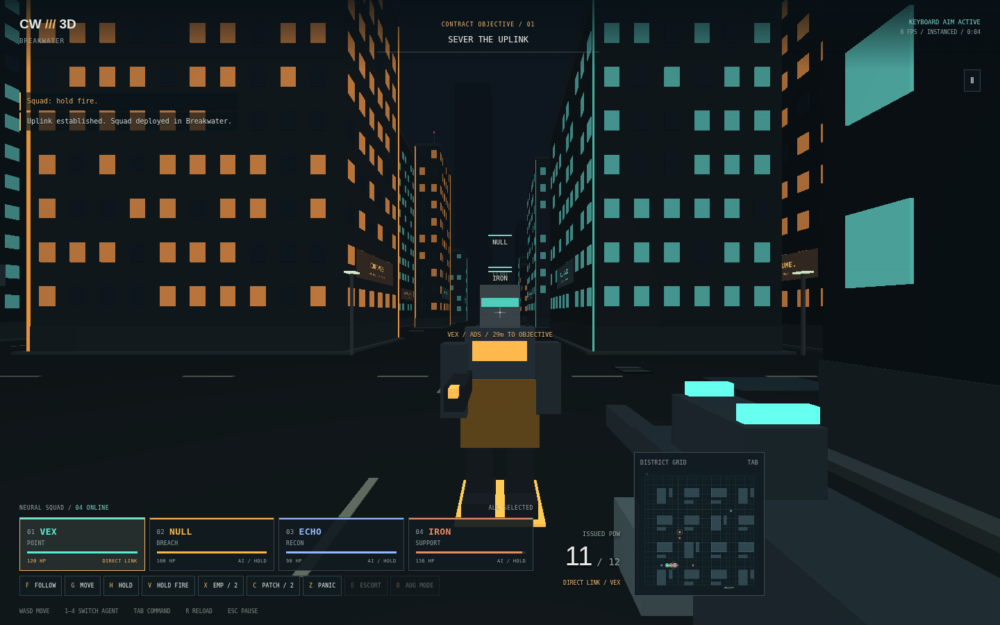

# CorpoWars3d

**Four bodies. One conscience. Corporate policy is about to change.**

A single-player tactical squad FPS by QSOL-IMC / Trent Slade. Pilot any of
CorpoWars' four agents from first person, then step out to a live tactical map
and command the whole squad. Unpiloted agents use the original CorpoWars AI:
they follow routes, acquire visible targets, fire, reload and operate objectives.

Native HTML, CSS and JavaScript. Raw WebGL, procedural geometry, local synth
audio and local saves. No engine, CDN, remote font, runtime packages or accounts.



*Packaged WebGL 2 build in Chromium CI using a software GPU. [Tactical view](docs/images/tactical.png) · [Exact run evidence](docs/QA_NATIVE_CI.json).*

## Games in this repository

| Game | Location | Launch |
| --- | --- | --- |
| CorpoWars3d — squad FPS | Repository root / `src/` | Browser, instructions below |
| **Dividend Zero — DOS demake** | [`games/dos/`](games/dos/README.md) | Real-mode DOS `.COM` in DOSBox |

The DOS game is a separate 2D run-and-gun: three districts, four switchable agents,
follow/hold orders, bitmap graphics and three original mathematical four-channel
MOD tracks. [Download the DOSBox-ready ZIP](games/dos/download/CORPO-DOS.zip),
extract it, and run `dosbox -conf DOSBOX.CONF` from the extracted folder.
The browser deployment continues to package only the FPS.

## Play locally

```sh
uv run --no-project python -m http.server 8000
```

Open `http://localhost:8000/` in a current desktop or mobile browser. Modules need HTTP rather
than a `file:` URL. WebGL 2 is preferred; WebGL 1 instancing and expanded-buffer
paths are included. Devices without WebGL automatically use a lower-detail
software 3D renderer. An optional service worker supports offline reload after
the first successful visit. Audio and browser storage fail gracefully.

## The squad

| Agent | Role | Original base HP | Base speed |
| --- | --- | ---: | ---: |
| VEX | Point | 120 | 2.6 tiles/s |
| NULL | Breach | 100 | 2.8 tiles/s |
| ECHO | Recon | 90 | 3.0 tiles/s |
| IRON | Support | 140 | 2.4 tiles/s |

One tile is 2.5 metres in the 3D presentation. Switching agents preserves their
health, ammunition, reload timers, orientation and outstanding route. Taking
the movement controls overrides that agent's route. Switching away hands them
back to AI; the rest of the squad keeps its own orders. Downed agents cannot be
piloted. If the active agent falls, control transfers to the next survivor.

## Controls

| Input | Action |
| --- | --- |
| WASD / mouse | Move / look |
| LMB / RMB | Fire / aim down sights |
| 1–4 / Q | Switch perspective / cycle living agents |
| Tab / M | Live tactical map; all four agents run on AI |
| Map click / right click visible enemy | Formation move / focus fire |
| Tactical agent card / Shift-click | Select one recipient / adjust selection |
| F / G / H | Follow active agent / move at aim / hold position |
| V | Toggle autonomous squad fire discipline |
| X / C / Z | EMP / selected squad medical patch / manual Panic burst |
| E / B | Escort released witness / cycle selected AUG conversions |
| R / Shift / Ctrl / J | Reload / sprint / crouch / jump |
| P / Esc | Pause; orders can be planned on the paused tactical map |
| Arrows / Space | Keyboard aim / fire; keyboard mode disables pointer lock |

### Xbox / standard gamepad

Connect a controller and press a button, then release the controls to arm it.
The browser must expose the standard Gamepad mapping; no vendor ID guessing.

| Control | FPS | Tactical map |
| --- | --- | --- |
| Left / right stick | Move / aim | Move map cursor / unused |
| RT / LT | Fire / aim down sights | Activate focused control / unused |
| A / X | Jump / reload | Move at cursor / attack visible enemy at cursor |
| B / Y | Hold crouch / cycle living agents | Return to agent / cycle selected recipient |
| LB or View / RB | Map / Follow | Return / select all agents |
| L3 / R3 | Hold sprint / hold crouch | — |
| D-pad ↑ / ↓ | Move at aim / Hold | Focus previous / next control |
| D-pad ← / → | Patch / EMP | Adjust focused setting |
| Menu | Pause / resume | Pause / resume planning |

Menus use D-pad ↑/↓ to focus, ←/→ to adjust settings, and A to activate.
All tactical commands, including Panic, are reachable with D-pad focus + RT.
Disconnecting the active controller pauses. Reconnect, resume and perspective
changes require neutral sticks/buttons before gameplay resumes. Separate
controller sensitivity and deadzone settings are in **System**.

### Mobile / touch

Touch controls appear automatically on coarse-pointer devices; **System → Touch
controls** can force them on or off. Left pad moves, right pad drags to aim.
Holding **FIRE** also accepts drag-to-aim, so moving, aiming and firing work with
two thumbs. ADS, sprint and crouch are held buttons; jump, reload, next agent and
Squad Map are taps. Independent pointers support simultaneous actions.

The map includes visible All / Viewed / Add Select / Pilot Selected / Focus Fire
controls on phones. Tap to move; enable Focus Fire and tap visible security to
attack. Pause remains accessible while planning. Portrait and landscape layouts
are included; landscape offers more view space. Mobile defaults to Balanced
resolution; saved quality preferences take precedence. Rotation and lost touch
capture cancel held controls. Browser zoom is not disabled.

The map is **live**. Press P to pause for planning: selection, map orders and
command shortcuts remain available while movement, combat and timers stop.
Press P or the resume button to apply the queued orders. While planning, Tab
navigates the controls and M returns to the paused first-person view.
To pilot a selected agent
from the map, use Pilot Selected, press 1–4 or double-click their card. Move orders include the
piloted agent's saved route, but direct input remains in charge until you leave
their view. Follow applies to selected teammates. Hold-fire governs AI triggers;
the operator can still fire manually.

Terminals and hold zones require a living agent to be stationary nearby. Direct
movement and jumping interrupt interaction even when the AI route is empty.
Complete the relay, then the second objective, then bring **every surviving
agent** into extraction. Witness Protection also requires the courier alive at
extraction: press E after release to keep selected agents escorting them.

## Contracts and headquarters

The six original contracts unlock in order: Hostile Takeover, Ghost Shift,
Boardroom Blackout, Signal Siege, Witness Protection and Golden Parachute.
**Premium Operations** extends that sequence with **Black Dividend**
(the Dividend Grid public-ledger broadcast and defended transmitter) and
**Proxy Election** (Apex Consolidated's register recovery and timed lockdown).
The new districts have their own seeded neon palettes and rooftop signal crowns;
visual props never change the collision/cover map. This expansion adds no paid
runtime unlock and preserves the original campaign save format.
The hold-out waves, courier escort and lockdown deadline retain CorpoWars'
original rules. Headquarters includes the original weapons, AUG conversions,
medical research, augmentations, panic upgrades and difficulty selection.
Rewards are paid once per contract. Optional medals also recognise zero-kill
extraction and four-agent survival on Hostile; they never mint credits or change
weapon balance. Campaign saves use a separate, validated
CorpoWars3d storage key. Returning to headquarters abandons an unfinished run;
only between-contract campaign progress is saved.

### Busier districts and Panic balance

Every district adds **8 street patrols on Relaxed / 12 on Hostile**, with longer
street routes and marksmen in later contracts. They begin at least 13 tiles
from the insertion squad. Completing the relay dispatches up to 4 / 6 response
units, once only, outside squad sight and at least 10 tiles away. Existing hold
waves and extraction reinforcements remain. There is no endless spawn timer.

**Panic is a manual, one-shot burst**, affecting only living hostiles in range
and line of sight of selected living agents at the instant of activation. It
never auto-fires when the cooldown ends, nor when a hostile later enters range.
Using it with no targets still consumes the burst. It cannot be used paused.

| Research | Effect (Relaxed) | Cooldown after the effect ends |
| --- | ---: | ---: |
| Base | 5 seconds | 24 seconds |
| Dread amplifier | 8 seconds | 18 seconds |
| Neural aftershock | 11 seconds | 14 seconds |

Hostile retains its 0.65× fear-duration modifier. The button shows ACTIVE,
remaining cooldown seconds, then READY. Switching agents/selection does not
reset cooldown. Campaign saves and purchased upgrades remain compatible.

## Character skins

Every person in the district has an original outfit built from the same
instanced cuboids as the city (`src/skins.js`):

| Character | Look |
| --- | --- |
| VEX | Long charcoal coat, teal collar and visor, shoulder pauldron, carbine |
| NULL | Full-face amber-visor helmet, hazard-banded chest plate, breaching charges, knee pads |
| ECHO | Deep hood, recon antenna, cape, single blue lens, long scoped rifle |
| IRON | Open-face helmet, beard, twin pauldrons, ammunition pack, LMG |
| Security | Issue uniform, peaked cap, badge, belt, red goggles, SMG |
| Bulwark | Heavy oxblood riot armour, visor slit, red shoulder beacons, breacher |
| Marksman | Field kit, beret, cape, scope lens, long rifle |
| Witness | Grey suit, white shirt, gold tie and briefcase on a gold ground ring |

**Colour lookup table.** In the manner of 1980s 8-bit games such as Elite
(1984), every colour lives once in a shared lookup table and each outfit is
eight one-byte indices into it. Changing a faction's colours is a table edit.

**Seeded crowds.** Security, Bulwark and Marksman faces and issue uniforms are
chosen by an Elite-style generator: three 16-bit seed words derived from the
actor id are "twisted" (`s0, s1, s2 → s1, s2, s0+s1+s2`), and their bytes pick
skin tone, hair, uniform shade and facial hair from the table. The same guard
always looks the same; the squad and the Witness are fixed characters. Type
silhouettes, weapons and red threat accents never vary, so enemies stay readable.

Skins are presentation only. Every standing part stays inside the 1.9 m shot
volume with heads in the headshot band, so what you see is what the hitscan
tests. Struck characters flash briefly; beyond 38 m characters drop small
detail parts, and the software renderer always uses that lower detail.

## Rendering and optimization

- Static city geometry uploads once per operation. Buildings, windows, kerbs,
  street details and skyline share one instanced draw batch.
- Skinned characters emit parts through a callback into the retained dynamic
  batch; variant colours and codes are cached in bounded tables, so steady
  frames allocate no per-actor arrays. Up close a character is 16–31 cuboids;
  past 38 m it is 12–15 (the previous model used 16).
- Articulated agents and effects use a retained dynamic batch; the weapon uses
  a separate retained batch. Original signs share one generated texture atlas.
- The primary path uses four draws per FPS frame, independent of instance count.
  WebGL 1 without instancing expands geometry into retained vertex buffers.
- VANILLAJS' fixed clock runs gameplay at 60 Hz with bounded catch-up and
  interpolated presentation. The original binary-heap routing workspace is kept.
- OPT invariant-driven rotation reuse avoids repeated trigonometry when cuboids
  have unchanged angles, preserving Float32 instance data; ordinary frames avoid
  allocating temporary concatenated squad/guard arrays.
- Ground-level jump trajectories use exact constant-acceleration integration
  across fixed steps, retaining the original cover/occupancy model.
- Cover rays reuse one private scratch box, reading every building field fresh;
  no per-building box/array allocation or approximate arithmetic is required.
- DOM references are retained, unchanged world-label text is reused and hidden
  touch minimaps are not redrawn.
- HUD/map updates are capped at 10 Hz. The map terrain and software renderer's
  static camera view use bounded caches with explicit invalidation.
- High, Balanced and Low resolution controls, reduced motion, keyboard aim,
  invert aim, sensitivity and independent audio/music volume are available.
- The classic inverse-square-root bit trick is benchmarked but **not enabled**:
  it introduces approximation without a demonstrated gameplay benefit.

See [architecture](docs/ARCHITECTURE.md), [performance and limitations](docs/PERFORMANCE.md)
and [donor provenance](docs/PROVENANCE.md). Controller/touch automation uses emulated devices; physical Xbox hardware, iOS
and Android touch feel are not certified by these tests.

## Verify and package

Development commands use an existing Node 22+ executable; no npm install is needed.

```sh
node --test tests/*.test.js
node scripts/check.js
node scripts/build.js
node scripts/benchmark.js
```

`dist/` is an allowlisted standalone static artifact. CI additionally uses
`uv` with pinned, CI-only Playwright to compile the real WebGL shaders and test
the packaged game under `/CorpoWars3d/`, including offline reload and simultaneous
mouse buttons, emulated Xbox input, multi-touch cancellation and both mobile
orientations. CI browser screenshots and telemetry are retained as artifacts.

The Pages workflow validates before deployment. For first publication, set
repository **Settings → Pages → Source → GitHub Actions**, then merge to main or
run **Deploy GitHub Pages**. Implementation PRs do not merge or publish themselves.

## Payhip collector bundle (staged, not published)

[Premium release and creative handoff plan](docs/PREMIUM_RELEASE.md) documents
the proposed **US$5** product, with the upgraded FPS, the included DOS bonus,
an independently authored short-story booklet and a future original song.
The Python standard-library packaging script makes a deterministic, locally
verifiable ZIP containing a SHA-256 manifest. GitHub Actions publishes a
**NOT-FOR-SALE preview artifact only**; story and music remain outside the
public repo until final authorised packaging. The release mode is blocked
unless both real media assets are supplied. Neither CI nor the script interacts
with Payhip or processes payments.

```sh
node scripts/build.js
python3 scripts/package_payhip.py --mode preview --out premium/out/PREVIEW.zip
python3 scripts/package_payhip.py --verify premium/out/PREVIEW.zip
```

## License

Apache-2.0. Preserve [LICENSE](LICENSE) and [NOTICE](NOTICE).
Syndicate is a genre reference; this game includes original QSOL source and
procedural assets. It is not affiliated with Electronic Arts or Bullfrog.
