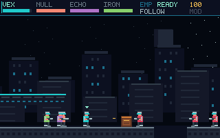

# Corpo Wars: Dividend Zero

**Four bodies. One conscience. Now in 320 × 200.**

A separate DOS 2D run-and-gun demake in the CorpoWars monorepo. Original bitmap
agents, neon city silhouettes, platforms, crates, guards and wardens. Three
side-scrolling districts contain 26 enemies each, medical caches, a relay to
breach and an extraction gate. Four agents keep their own health while you
switch control; the others follow or hold and fire autonomously.



## Play in DOSBox

1. [Download `CORPO-DOS.zip`](download/CORPO-DOS.zip) and extract the whole folder.
2. Install DOSBox 0.74-3 (or a compatible DOSBox version).
3. Open a host terminal **inside the extracted `CORPO-DOS` folder** and run:

```sh
dosbox -conf DOSBOX.CONF
```

On Windows this command is `dosbox.exe -conf DOSBOX.CONF`; use its installed path
if DOSBox is not on PATH. Alternatively, start DOSBox, mount the extracted folder
as C, change to C and run `CORPO.COM`. No browser or server is required. The
provided configuration mounts only the extracted game folder.

Target: **386 or newer, real-mode DOS, VGA, 640 KB conventional RAM recommended**.
This is a 16-bit real-mode program compiled using GCC's i386 register/ABI model;
it uses 386 instructions and will not run on an 8086/286. No protected-mode DOS
extender, runtime library or floating-point unit is needed.

## Controls and objectives

| Input | Action |
| --- | --- |
| Left/right arrows or A/D | Run and face the firing direction |
| Space, W or up arrow | Jump |
| Ctrl or X | Fire, unlimited ammunition |
| 1–4 or Q | Select / cycle living agents |
| F / H | Followers move with the pilot / hold their position |
| E, held while stationary | Breach the district relay |
| Z | Brief nearby enemy firing stun, **15 seconds of simulation cooldown** |
| P | Pause / resume; release movement and fire controls to rearm |
| M | Mute / unmute music and effects |
| Enter | Start or retry the campaign |
| Esc | Quit to DOS |

Breach the relay, defeat the warden, then reach the EXIT. Platforms and crates
block shots. Friendly bullets pass through squadmates in this platformer. Health
carries between districts; medical caches restore 35 HP. A fallen pilot transfers
control to a survivor. Losing the squad ends the run; Enter starts a new campaign.
Panic delays nearby enemies' firing for up to 120 ticks; it deals no damage.

The first release is keyboard single-player. Controller/mobile controls remain
features of the browser FPS. There is no save system in the DOS campaign.

## Tiny mathematical music

All three **four-channel M.K. modules are 7,932 bytes each**. Six instruments are
synthesized from FM/additive waves, exponential envelopes and deterministic noise.
Exact E8 root walks choose the lead phrase; harmony and rhythms are authored.
[Recipes, mapping and donor commits](docs/PROVENANCE.md) document the connection
to QSOLKCB **SONIFICATION** and **E8_MUSIC**. No recordings are used.

Classic Amiga MODs have **8-bit samples**. Our tiny player mixes them to **16-bit
signed mono at 11,025 Hz**, with Sound Blaster 16 auto-init DMA. PC speaker pulses
provide effects separately from the four music voices. This player deliberately
supports only the authored note/instrument, Cxx and Fxx subset, not arbitrary MODs.

The provided DOSBox settings use `BLASTER=A220 I5 D1 H5 T6`. Supported hardware
settings are DSP 4.xx, base A210–A280 in 0x10 steps, IRQ 5/7 and high DMA 5/6/7;
IRQ/DMA mixer configuration must match BLASTER. Missing/malformed music or
unsupported audio settings leave the game playable in silence. Real hardware,
other emulators and physical keyboard latency have not been measured.

## Build and verify

Linux reference toolchain: GCC **13.3**, GNU binutils **2.42**, Python **3.12+**,
DOSBox **0.74-3**. On Ubuntu 24.04, development tools are `gcc binutils dosbox`.
GCC can emit `-m16` without multilib libc packages; the game has no libc imports.
Python scripts use only the standard library, with no package downloads.

From the repository root:

```sh
uv run --no-project python games/dos/tools/check.py
uv run --no-project python games/dos/tools/build.py
uv run --no-project python games/dos/tools/smoke.py
```

`dist/CORPO-DOS.zip` is the launch package. `dist/evidence/` contains DOSBox frame
dumps converted to PNG, a DMA sample capture, logs and JSON. The small committed
[download](download/CORPO-DOS.zip) is rebuilt and compared byte-for-byte by CI
with the reference toolchain. Other compiler versions may produce a different
binary; the game should still build, but that is not a byte-identity claim.

`check.py` rebuilds and compares generated assets, verifies E8 invariants, and
runs C address/undefined-behavior sanitizer tests: all three districts through
combat and extraction, actor/cover collision, follow/hold, switching, death,
stationary terminals, paused time, cooldowns, malformed MODs and 70-second mixes.
`smoke.py` executes the actual COM, checks VGA captures and nonzero SB16 DMA data,
runs twice in one DOS session, and tests mismatched hardware, missing music and
corrupt music. `/TEST` injects game commands; it is not a physical-input test.
[Checked local evidence](docs/QA.json) records the tested binary and source hashes.

To regenerate art/music after recipe changes:

```sh
uv run --no-project python games/dos/tools/assets.py
```

## Layout and bounds

- `src/game.c`: deterministic 35 Hz simulation, integer 8-fractional-bit positions,
  four agents, 26 enemies and 48 projectiles; pixel-swept actor/projectile collision.
- `src/render.c`: clipped VGA framebuffer drawing, generated bitmap font/sprites,
  parallax skyline and HUD. No per-frame allocation.
- `src/mod.c`: bounded MOD parser and four-voice integer mixer, shared with host tests.
- `src/hardware.c`, `start.S`: DOS file/memory calls, keyboard/timer IRQs, VGA,
  SB16 DMA and restoration on exit. The BIOS timer is chained at its original rate.
- `tools/`: deterministic assets, freestanding build and emulator verification.

The main COM code/data must fit below 0xE000, leaving at least 8 KB for its stack.
A separate 64 KB framebuffer and 2 KB DMA allocation live in conventional memory.
The DMA buffer stays inside a 64 KB boundary. Simulation catch-up is capped at
four steps. These are explicit bounds, not benchmarked speedup claims.

Apache-2.0. Original source, graphics, samples and music; see [provenance](docs/PROVENANCE.md).
